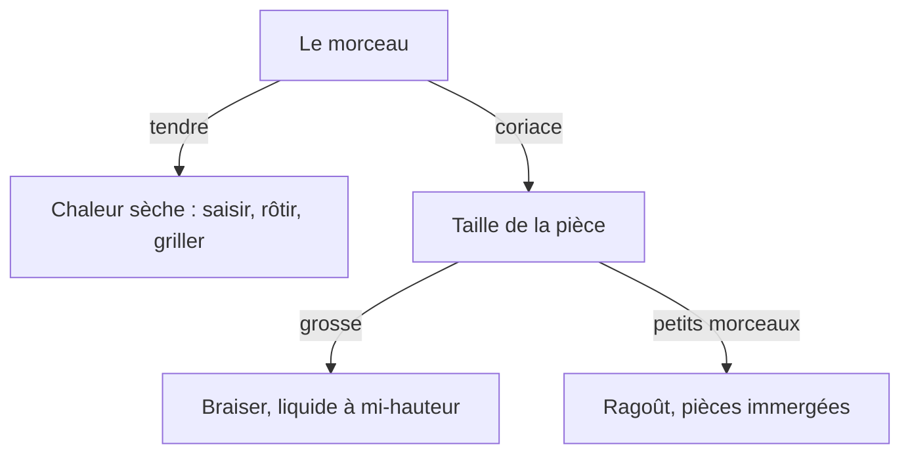

# Blocs Comark — pages et articles

Une page technique et un article restent un **texte**. Un bloc n'entre que si le lecteur doit **voir** une différence, un ordre, ou un choix. Serious Eats, America's Test Kitchen, Ricardo, La-viande.fr : photo, face-à-face, ou tableau. Pas un arbre de décision pour une suite droite.

Lab visuel (draft, `noindex`, ne pas publier) : page id 21, slug `lab-blocs`. Preview : `/preview?type=page&slug=lab-blocs`. Y juger le rendu avant d'inventer une variante.

## Surfaces

| Surface | Renderer | Blocs |
|---|---|---|
| Page CMS | `PageMarkdown` | Tout le catalogue, y compris les sections d'accueil |
| Article / recette | `ArticleMarkdown` | `callout`, `grid`, `table`, `timeline`, `carousel`, `faq` + images markdown + fence `mermaid` |

Jamais `::image`. Jamais `::hero` / `::newsletter` / `::hubs` / `::person` / `::article-list` dans un article. `::recipe-list` seulement sur une page (deux ou trois recettes publiées du verbe).

Rendu commun : filet **yellow-800**, coins **droits**, Catamaran / Merriweather. Pas de pastels, pas de zébrure, pas de titre générique « Info / Astuce / Attention » à l'écran.

## Quelle forme, à quel moment

| Le contenu | La forme |
|---|---|
| Une main, un outil, un geste | Une photo pleine largeur |
| Mise en place, découpes où l'échelle compte | Une photo pleine largeur |
| Deux résultats au même point d'arrivée | `::grid{cols="2"}`, légende qui nomme chaque côté |
| Suite où chaque pas change la forme (julienne) | `::grid{cols="3"}`, même angle, légendes numérotées |
| Huit temps, même cadrage | `::grid{cols="2"}` et huit cellules |
| Plusieurs états, mêmes colonnes (cuisson, comparatif, dates) | `::table` — pas un tableau en pipes |
| Une limite, un mythe, une source | `::callout` |
| Un choix à **au moins deux branches** | Un fence `mermaid`, six nœuds max |
| Une suite droite (saisir, déglacer, mouiller) | Liste numérotée |
| Une histoire datée (article, pas une méthode) | `::timeline`, 4–6 items |
| 3–5 questions fréquentes (PAA, combien / comment) | `::faq` — pas un `## Questions fréquentes` en prose |

## Images

Uniquement ``, après `list-media`. `generate-media` renvoie `markdownPath` déjà préfixé : l'employer tel quel. Le `alt` décrit le geste ou le plat. Une ligne visible sous la photo répète ce que la photo montre, sans « à gauche » ni « ci-dessus » : le téléphone empile.

Prompt (source unique : `../jdc-article-writer/references/image-selection-criteria.md`) : on ne réécrit pas la lumière, la table, l'angle. Seul le sujet change. `aspectRatio: "4:3"`.

```
Professional food photography of <sujet>,
natural window light, shallow depth of field,
rustic wooden table, 45-degree angle, no text, no logos
```

`<sujet>` en anglais, nommé en entier. `no hands` sauf si la photo existe pour la main : alors `one bare hand, no jewelry, no nail art`. `list-media` d'abord. Geste cadré (main, outil, face-à-face) → **générer tout de suite**. Stock seulement pour un plat fini. Les cellules d'une grille partagent le prompt ; seul le sujet change.

## Encadré — `::callout`

`type` : `info` (source d'un chiffre), `tip` (le geste qui rate), `warning` (mythe ou danger). L'icône porte le type. **Le titre générique est `sr-only`** : ne pas commencer le corps par « Info », « Astuce » ou « Attention ». La première phrase *est* le sujet.

```markdown
::callout{type="warning"}
La croûte n'enferme pas les sucs. Kenji : deux steaks au même cœur, celui saisi d'abord n'est pas le plus juteux.
::
```

Un seul `warning` par page méthode. Le degré ANSES reste dans l'encadré ou le tableau, pas seulement dans un nœud Mermaid.

## Grille — `::grid`

`cols` = 2, 3 ou 4. Pas de prop `rows` : le nombre de `:::div` fait les rangées. Le téléphone empile dans l'ordre du markdown.

Deux présentations, **pas un nouveau bloc** : `variant` oublié = photos (défaut). `variant="cards"` enveloppe chaque cellule dans un `UPageCard` Nuxt UI (filet, coins droits). Les comparaisons photo restent en `media`. Les listes de feuilles (méthodes, hub) passent en cartes.

```markdown
::grid{cols="2"}
:::div


Saisie d'abord : bande grise sous la croûte, même cœur.
:::
:::div


Four doux puis saisie : rosé jusqu'à la croûte, même cœur.
:::
::
```

Même cadrage dans une suite. Une cellule qui coupe la main hors du geste redevient une photo pleine largeur. Quatre points de cuisson : un `::table` (nom, aspect, température, source). Une grille `cols="4"` seulement si chaque légende porte tout ça — la couleur seule ne tient pas une fois empilée.

Hub ou sous-hub, une carte par enfant réel :

```markdown
::grid{cols="2" variant="cards"}
:::div
### Saisir

Peu de gras, feu vif, sans couvercle.

[Comment saisir une viande](/techniques-culinaires/methodes-de-cuisson/saisir-viande-parfaitement)
:::
:::div
### Braiser

Colorer, puis liquide à mi-hauteur, couvercle.

[Comment braiser une viande](/techniques-culinaires/methodes-de-cuisson/guide-braisage-plats-mijotes)
:::
::
```

Titre `###`, une ou deux phrases, un lien. Pas d'image dans une carte : la photo reste en `::grid` sans `variant`, ou pleine largeur.

## Tableau — `::table`

Attributs JSON, fermer avec `::`. Un tableau markdown `| A | B |` devient un **bloc vide** (le renderer mappe `table` sur ce composant, sans `head`/`rows`).

```markdown
::table{head='["Repère","Cœur","Source"]' rows='[["Bleu","vers 45 °C","école Versailles"],["Saignant","vers 52 °C","école Versailles"]]' caption="Goût et sécurité ne partagent pas une ligne sans étiquette."}
::
```

Première colonne = le nom (serif). Caption au-dessus. JSON dans des `'…'` : pas d'apostrophe ASCII dans une cellule (`l’ANSES` typographique, ou reformuler).

Ça tient : points de cuisson, comparatif d'ustensiles, « quelle méthode pour quelle pièce ». Ça ne tient pas : un paragraphe déguisé en une colonne.

## Frise — `::timeline`

Articles d'histoire / migration. **Pas sur une page méthode** : une suite de gestes est une liste numérotée.

```markdown
::timeline{items='[{"date":"1680","title":"Le nom","text":"Une phrase, pas un paragraphe."}]'}
::
```

4–6 items. `text` ≤ 2 lignes. Une date par item. Le paragraphe autour dit la même chose.

## FAQ — `::faq`

Accordéon Nuxt UI (`UAccordion`, `type="multiple"`, réponses laissées dans le DOM) + schema `FAQPage` / `Question` via Unhead (`defineWebPage({ '@type': 'FAQPage' })` + `defineQuestion`). Ne pas coller de JSON-LD dans le markdown.

```markdown
::faq{items='[{"question":"Quelle huile pour saisir ?","answer":"Une huile qui tient le vif. Le beurre seul brunit trop tôt."}]'}
#title
Questions fréquentes
::
```

3–5 questions du SERP / PAA. JSON dans des `'…'` : pas d'apostrophe ASCII dans une réponse (`l’huile` typographique, ou reformuler). Recettes : le champ CMS `faq` passe par le même composant.

## Schema (Unhead / Nuxt SEO)

Le markdown n'émet pas de JSON-LD. Les types utiles sont déjà branchés :

| Type | Où | Pas pour |
|---|---|---|
| `FAQPage` + `Question` | Bloc `::faq`, champ recette `faq` | Coller un script dans le corps |
| `Recipe` | Route `/recette/:slug` | Une page méthode |
| `Article` | Route article | Une page CMS |
| `BreadcrumbList` | Pages, depuis les parents | Recalculer à la main |
| `WebSite` + identité | `app.vue` / `nuxt.config` | Le bloc `::person` |

Pas de `HowTo` : Google l'a restreint, et on n'a pas de bloc d'étapes. Pas de `ItemList` tant qu'il n'y a pas de listicle dédié. Google ne montre plus les rich results FAQ depuis le 7 mai 2026 ; le markup Schema.org reste.

## Mermaid

Fence `mermaid` (plugin Comark), thème `base` du site (Catamaran, filet yellow-800, coins droits). **Pas de `%%{init:…}%%`** dans le fence.

Au moins deux branches. Six nœuds max. Chaque flèche a un mot. Le paragraphe sous le schéma dit la même chose. Un seul schéma par URL. Si la page doit montrer l'aliment, la photo gagne.

Ça tient : tendre ou coriace, frémissement ou gros bouillons. Ça ne tient pas : chemin de la chaleur dans un four, aspect bleu / saignant, barèmes ANSES, millimètres de coupe, braiser contre bouillir contre ragoût (c'est un tableau).

````markdown

````

À la review : le SVG est dessiné, le source du fence n'est pas à l'écran.

## Liste de recettes — pages seulement

```markdown
::recipe-list{source="slugs" slugs="boeuf-bourguignon-traditionnel,poulet-yassa" limit="3"}
#title
Recettes qui saisissent
::
```

Slugs **publiés**, vérifiés avec `list-recipes`. `limit` 2 ou 3.

## Carrousel

Existe sur article/recette (`images` JSON, `src` en `uploads/…`). Préférer une photo ou une grille : le carrousel recadre et empile mal sur téléphone. Interdit sur une page technique.

## Sections d'accueil — pages seulement

`::hero`, `::newsletter`, `::hubs`, `::person`, `::article-list`. `create-page` sans `content` les pose tout seul : toujours envoyer le corps.

## Syntaxe

Fermer chaque bloc avec `::`. JSON dans des attributs `'…'`. Un `::` ou `**` visible sur le preview = Comark cassé.

Un composant qui manque se crée dans `packages/shared/blocks/<tag>/` (`Client.vue`, `Editor.vue`, `Simple.vue`, ligne dans `catalog.ts`). Le markdown appelle `::<tag>`. Il n'appelle pas `::u-alert`.
