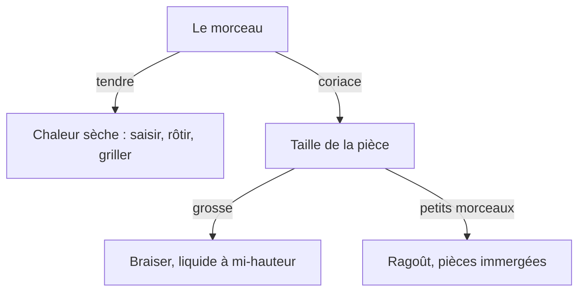

# Quand sortir du paragraphe

Lab visuel (draft, `noindex`, ne pas publier) : page id 21, slug `lab-blocs`. Preview : `https://journalducuistot.fr/preview?type=page&slug=lab-blocs`. Tous les blocs du catalogue y sont posés une fois, dans le layout contenu.

Une page technique reste un texte. Une image, une grille, un tableau ou un diagramme n'entre que si le lecteur doit **voir** une différence, un ordre, ou un choix. Les exemples viennent de Serious Eats, America's Test Kitchen, Ricardo, La-viande.fr, BPI et les fiches de Versailles (octobre 2026). Aucune de ces pages n'utilise un arbre de décision ni une frise : elles utilisent une photo, un face-à-face, ou un tableau.

Les images s'écrivent **uniquement** ``, après `list-media`. Pas de `::image`, pas de `::carousel`. Le `alt` décrit le geste. Une ligne visible sous la photo répète ce que la photo montre, sans « à gauche » ni « ci-dessus » : sur téléphone la grille passe en une colonne.

`generate-media` renvoie `markdownPath` déjà préfixé (`/uploads/…`). On l'emploie tel quel dans ``.

## Prompt — le même style que le reste du site

Source unique : `../jdc-article-writer/references/image-selection-criteria.md`, section « Prompt de génération ». On ne réécrit pas la lumière, la table, l'angle, ni les interdits. Seul le sujet change. `aspectRatio: "4:3"`. Modèle par défaut.

```
Professional food photography of <sujet>,
natural window light, shallow depth of field,
rustic wooden table, 45-degree angle, no text, no logos
```

`<sujet>` est le geste ou le plat, en anglais, nommé en entier (« a steak searing in a cast-iron skillet until the surface browns », pas « meat »). Pour un plat fini, garder aussi la vaisselle et la garniture du prompt article (`served on rustic ceramic, appetizing garnish`).

`no hands` du prompt article reste, sauf quand la photo existe pour montrer la main (prise du couteau, retournement). Dans ce cas seulement : `one bare hand, no jewelry, no nail art`, et le reste du prompt ne bouge pas.

`list-media` d'abord. Un fichier qui montre déjà ce geste gagne.

S'il n'y est pas, **générer tout de suite** pour le contenu qui doit être cadré : une main, un outil en cours de geste, une mise en place, une suite d'étapes, un face-à-face (deux croûtes, deux prises, trois temps d'une julienne). Le stock ne tient pas le même angle d'une cellule à l'autre, et il sort du style du site. Les cellules d'une même grille partagent le prompt ; seul le sujet de la cellule change.

Le stock (`search-stock-media` puis `import-stock-media`) reste pour une photo de plat fini, après un `list-media` vide. Pas pour un geste.

Une photo générée se note dans le compte-rendu.

## Quelle forme, à quel moment

| Le contenu | La forme |
|---|---|
| Une main, un outil, un geste qui traverse le cadre (retourner, arroser) | Une seule photo pleine largeur |
| Mise en place, ou une assiette de découpes où la taille relative compte | Une seule photo pleine largeur. Huit tas séparés perdent l'échelle |
| Deux résultats au même point d'arrivée (même cœur, deux croûtes, deux prises de couteau) | Grille `cols="2"`, deux cellules. La légende nomme chaque côté |
| Une suite où chaque pas change la forme (julienne : à plat, lamelles, bâtonnets) | Grille `cols="3"`, trois cellules, même angle, légendes numérotées |
| Huit temps du même geste, même cadrage | Grille `cols="2"` et huit cellules : 2 colonnes × 4 rangées. L'ordre de lecture est 1, 2, 3… |
| Quatre points de cuisson (bleu, saignant, à point, bien cuit) | Tableau : nom, aspect, température, et la source. Une grille `cols="4"` seulement si chaque légende porte le nom, l'aspect et le degré — la couleur seule ne tient pas une fois empilée |
| Quelle méthode pour quelle pièce | Tableau à trois colonnes : mode, ce qu'il fait, les pièces. Pas un diagramme |
| Tailles de coupe (julienne, brunoise) | Liste de mesures sous le geste. Photo seulement pour le mouvement difficile (le côté plat) |
| Une limite ou une température de sécurité | `::callout`. Le degré ANSES reste dans l'encadré ou le tableau, pas seulement dans un nœud |
| Un choix à au moins deux branches | Un seul diagramme Mermaid, six nœuds maximum |
| Une suite droite (saisir, puis déglacer, puis mouiller) | Liste numérotée. Un diagramme en ligne droite répète la liste |

## Grilles

`::grid{cols="2"}` accepte 2, 3 ou 4 colonnes. Il n'y a pas de prop `rows` : le nombre de cellules `:::div` fait les rangées. Quatre cellules en 2 colonnes = 2 rangées. Huit cellules en 2 colonnes = 4 rangées. Le téléphone empile dans l'ordre du markdown.

```markdown
::grid{cols="2"}
:::div


Saisie d'abord : bande grise sous la croûte, même cœur.
:::
:::div


Four doux puis saisie : rosé jusqu'à la croûte, même cœur.
:::
::
```

Trois photos d'une découpe, dans l'ordre :

```markdown
::grid{cols="3"}
:::div


1. Côté plat, pour que le légume ne roule plus.
:::
:::div


2. Lamelles de même épaisseur.
:::
:::div


3. Bâtonnets de 1 à 2 mm.
:::
::
```

Même cadrage dans chaque cellule d'une suite. Une cellule qui coupe la main hors du geste redevient une photo pleine largeur.

## Mermaid

`BaseMarkdown` charge `comark/plugins/mermaid`. Un fence `mermaid` devient `apps/web/app/components/comark/Mermaid.vue` (côté client, thème `base` Journal du Cuistot : Catamaran, filet yellow-800, coins droits). Ne pas poser de `%%{init:…}%%` dans le fence : la couleur du site vient du plugin.

Un diagramme seulement s'il y a **au moins deux branches**. Six nœuds maximum. Chaque flèche a un mot (oui, non, monter le feu). Le paragraphe sous le schéma dit la même chose. La couleur ne porte pas le sens toute seule. Pas de deuxième schéma sur la page. Si la page doit montrer l'aliment, la photo gagne et le schéma passe sur une autre page, ou disparaît.

Ça tient : tendre ou coriace, frémissement ou gros bouillons, la fourchette s'enfonce ou on reste à couvert.

Ça ne tient pas : le chemin de la chaleur dans un four, l'aspect bleu / saignant, les barèmes ANSES (trop de lignes), les millimètres des coupes, braiser contre bouillir contre ragoût (c'est un tableau, pas une suite).

````markdown

````

À la review, le SVG est dessiné. Le source du fence ne reste pas à l'écran.

## Le reste

| Bloc | Moment |
|---|---|
| `::callout{type="warning"}` | Un mythe ou un danger. `tip` = le geste qui rate. `info` = la source d'un chiffre. |
| `::table{head='["A","B"]' rows='[["1","2"]]' caption="…"}` puis `::` | Plusieurs états, mêmes colonnes. Un tableau en pipes `| A | B |` devient un bloc vide sur les pages. |
| `::recipe-list{source="slugs" slugs="…" limit="3"}` | Deux ou trois recettes publiées qui utilisent le verbe. |

`::hero`, `::newsletter`, `::hubs`, `::person`, `::article-list` restent des sections d'accueil. `create-page` sans `content` les pose tout seul : toujours envoyer le corps.

Un composant qui manque se crée dans `packages/shared/blocks/<tag>/` (`Client.vue` avec les bases Nuxt UI déjà utilisées : `UAlert`, `UButton`, `UPageCard`…, plus `Editor.vue`, `Simple.vue`, et une ligne dans `catalog.ts`). Le markdown appelle `::<tag>`. Il n'appelle pas `::u-alert`.
